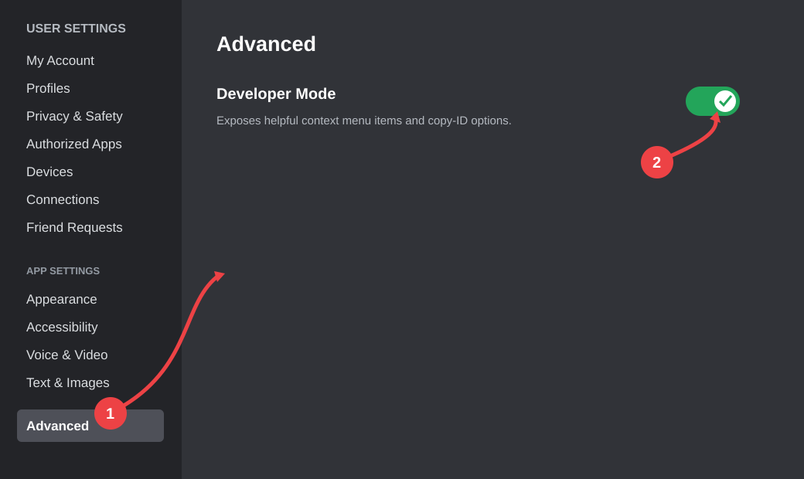

# Discord Orbs

Discord Orbs is a Windows executable distributed through the repository's
[Releases](../../releases) page.

> **Important:** This project is provided as-is. The author created the
> original code and does not accept responsibility for any damage, account
> action, data loss, or other consequence resulting from its use. Use it at
> your own risk.

## Requirements

- Windows
- Discord with **Developer Mode** enabled
- The `.exe` file downloaded from a release of this repository

## Setup

### 1. Enable Developer Mode in Discord

1. Open Discord and select **User Settings** (the gear icon).
2. Select **Advanced** in the left-hand menu.
3. Turn on **Developer Mode**.

The illustration above is a project-created guide based on Discord's desktop
settings layout. Discord may change the names or position of these options in
future updates.

### 2. Run Discord Orbs

1. Open the [latest release](../../releases/latest).
2. Download the `.exe` asset attached to that release.
3. Run the executable on your Windows computer.
4. Follow any instructions shown by the application.

Only download executable files from releases published in this repository.
Windows or antivirus software may display a warning for unsigned files; review
the release information before deciding whether to continue.

## Releases

Executable files are supplied only through GitHub Releases. The source
repository does not include prebuilt binaries in the main branch.

## No modification or support promise

The source code and release files are published for this project only. Do not
modify, repackage, redistribute, or claim authorship of them. No warranty,
maintenance commitment, or support promise is made.

## License

All rights reserved. See [LICENSE](LICENSE).
